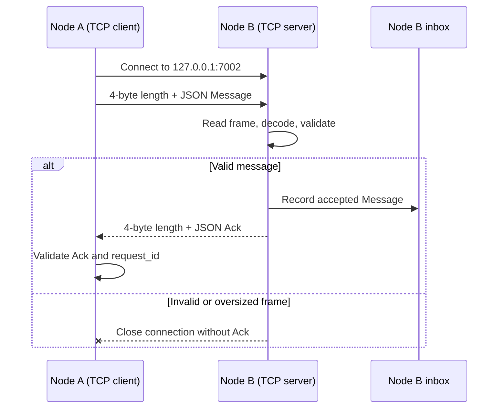

# CW1 Distributed System — API and Communication Protocols

## 1. Overview

The Week 4 application consists of two peer nodes that exchange JSON messages using TCP or UDP. Each node also exposes an HTTP endpoint for inspecting received messages. The communication protocol is versioned (`version: 1`) and uses a request/acknowledgement exchange.

Example local configuration:

| Node | HTTP | TCP | UDP |
| --- | --- | --- | --- |
| Node A (`node-a`) | `127.0.0.1:8081` | `127.0.0.1:7001` | `127.0.0.1:7101` |
| Node B (`node-b`) | `127.0.0.1:8082` | `127.0.0.1:7002` | `127.0.0.1:7102` |

## 2. Message schema

A request is a JSON object with these fields:

| Field | Type | Purpose |
| --- | --- | --- |
| `version` | integer | Protocol version; must be `1` |
| `request_id` | string | Request identifier; must satisfy `config.ValidID` |
| `node_id` | string | Sending node identifier; must satisfy `config.ValidID` |
| `text` | string | Nonempty UTF-8 text of at most 512 bytes |

Example:

```json
{"version":1,"request_id":"tcp-1","node_id":"node-a","text":"hello"}
```

Validation rules:

- Only version `1` is accepted.
- `request_id` and `node_id` must pass `config.ValidID`.
- `text` must be valid UTF-8 and contain between 1 and 512 bytes (not characters).
- Encoded JSON payloads must contain between 1 and `4096` bytes (`MaxMessage`).
- JSON decoding rejects unknown fields, malformed JSON, and multiple consecutive JSON values.

## 3. Acknowledgement schema

A successfully accepted request produces an acknowledgement:

```json
{"version":1,"request_id":"tcp-1","receiver":"node-b","accepted":true}
```

| Field | Type | Purpose |
| --- | --- | --- |
| `version` | integer | Protocol version (`1`) |
| `request_id` | string | Must match the original request |
| `receiver` | string | Identifier of the receiving node; must be nonempty |
| `accepted` | boolean | Must be `true` for a successful exchange |

The sender rejects an acknowledgement if its version or request ID is incorrect, its receiver is empty, or `accepted` is false. An acknowledgement confirms processing by the receiving server; it does not imply durable storage.

## 4. TCP protocol

TCP is a reliable, ordered byte stream, so the application defines explicit message boundaries using **length-prefixed frames**.

Frame layout:

```text
+------------------------------+------------------------------+
| 4-byte unsigned length (BE)  | JSON payload (1–4096 bytes)  |
+------------------------------+------------------------------+
```

The first four bytes encode the payload length in network byte order (big-endian). `WriteFrame` handles short writes; `ReadFrame` reads the complete header and payload even if the underlying connection returns fragmented reads. Zero-length and oversized frames are rejected.

TCP request flow:

1. Sender validates and JSON-encodes a `Message`.
2. Sender connects to the destination TCP listener and writes one framed request.
3. Receiver reads and validates the frame and message.
4. Receiver invokes the message callback, when configured, to record the accepted message.
5. Receiver writes a framed JSON `Ack`.
6. Sender reads, decodes, and checks the acknowledgement.
7. The connection closes.

### TCP sequence diagram



The TCP server uses a per-connection timeout and bounds concurrent handlers. Cancellation closes the listener and active connections, allowing the server to shut down.

## 5. UDP protocol

UDP is datagram-oriented. Each UDP datagram contains **one JSON request or acknowledgement**, with **no TCP-style length prefix**.

UDP request flow:

1. Sender validates and JSON-encodes a `Message`.
2. Sender sends the JSON bytes in a single datagram to the destination UDP port.
3. Receiver reads the datagram into a `MaxMessage + 1` byte buffer.
4. Receiver discards empty, oversized, malformed, or invalid messages without acknowledgement.
5. For valid requests, receiver invokes the message callback and sends a JSON `Ack` datagram to the sender.
6. Sender reads and validates the acknowledgement before its deadline.

### UDP sequence diagram

```mermaid
sequenceDiagram
    participant A as Node A (UDP client)
    participant B as Node B (UDP server)
    participant I as Node B inbox
    A->>B: JSON Message datagram to port 7102
    B->>B: Decode and validate datagram
    alt Valid message
        B->>I: Record accepted Message
        B-->>A: JSON Ack datagram
        A->>A: Validate Ack and request_id
    else Invalid datagram
        Note over B: Drop datagram; no Ack
    end
    Note over A: Timeout if no valid Ack arrives
```

UDP does not guarantee delivery, ordering, or duplicate suppression. This implementation does not automatically retry failed requests.

## 6. Timeouts, cancellation, and errors

- Default operation timeout: **2 seconds** when a nonpositive timeout is supplied.
- The client combines the supplied context deadline with the configured timeout and uses the earlier deadline.
- Client cancellation interrupts network I/O.
- TCP handlers enforce per-connection deadlines and reject incomplete or invalid frames.
- An invalid TCP request closes that connection without bringing down the listener.
- Invalid UDP datagrams are dropped without acknowledgement.
- Server cancellation closes its network listener/socket; the TCP server waits for active handlers to finish.

A timeout or missing acknowledgement should be reported as a failed exchange, not assumed to mean the receiver did not process the message. A response can be lost after a message has already been accepted.

## 7. HTTP inspection endpoint

Each node exposes:

```http
GET /v1/messages
```

A successful response uses HTTP `200` with JSON content containing the node's recent accepted messages. The inbox retains up to **20** messages.

Example inspection commands:

```powershell
Invoke-RestMethod http://127.0.0.1:8081/v1/messages
Invoke-RestMethod http://127.0.0.1:8082/v1/messages
```

Example response from Node B:

```json
[
  {"version":1,"request_id":"tcp-1","node_id":"node-a","text":"hello"},
  {"version":1,"request_id":"udp-1","node_id":"node-a","text":"hello"}
]
```

The inbox is an in-memory recent-message view, not a durable queue. Repeated requests with the same `request_id` can appear multiple times; the observed live test produced duplicate entries after repeated sends.

## 8. TCP versus UDP

| Property | TCP | UDP |
| --- | --- | --- |
| Transport | Connection-oriented byte stream | Connectionless datagrams |
| Application framing | 4-byte big-endian length prefix | One JSON document per datagram |
| Delivery | Reliable, ordered stream while connection remains healthy | No delivery or ordering guarantee |
| Message boundaries | Added by `WriteFrame` / `ReadFrame` | Preserved by datagram boundary |
| Failure response | Invalid request closes connection | Invalid request is silently dropped |
| Success response | Framed JSON acknowledgement | JSON acknowledgement datagram |
| Timeout handling | Connection I/O deadline | Datagram send/read deadline |
| Retry / deduplication | No automatic retry or deduplication | No automatic retry or deduplication |

**Choice:** TCP is suitable when reliable ordered transport matters. UDP is simpler for small independent messages but requires application-level handling for loss, reordering, and duplicates if those guarantees are needed.

## 9. Verification and evidence

Completed automated checks included message validation boundaries, malformed JSON, frame fragmentation and limits, incomplete frames, TCP/UDP round trips, oversized TCP rejection, malformed UDP drop, cancellation, and the full project race-enabled test suite:

```powershell
go test -race ./... -count=1
```

The full project test run passed without reporting data races. Live inbox inspection also confirmed that both nodes received TCP and UDP messages from their peer.

Additional TCP timeout/recovery tests should be recorded separately if added and run; they were not individually confirmed in the supplied test output.

Suggested evidence directory:

```text
evidence/week04/
  tcp-node-a-to-b.txt
  udp-node-a-to-b.txt
  tcp-node-b-to-a.txt
  udp-node-b-to-a.txt
  node-a-inbox.txt
  node-b-inbox.txt
  ipc-race-tests.txt
  full-race-tests.txt
```
